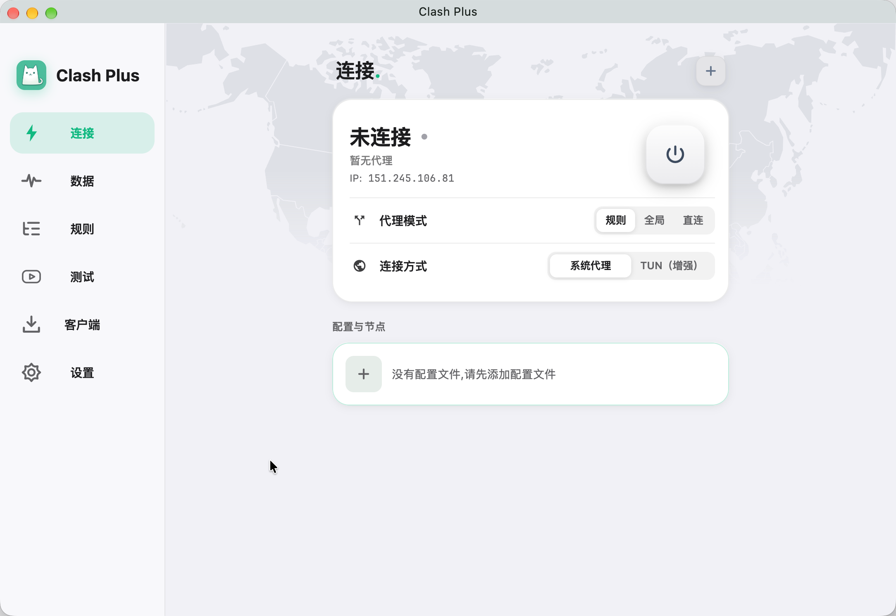
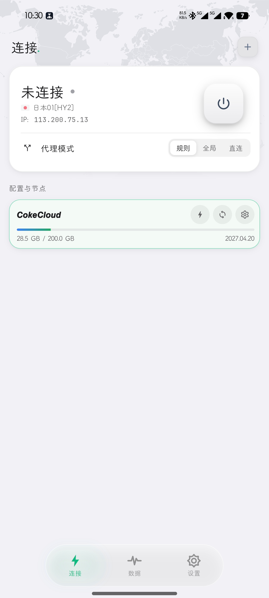
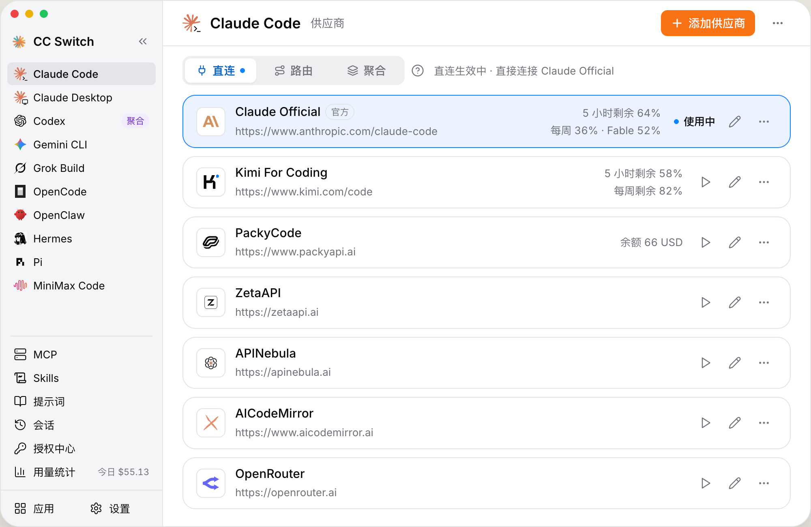

# 跨平台软件包


## 一、文档解析工具

### 1.MinerU

* 支持平台: Windows, Mac, Linux

* 官网: https://mineru.net

* 项目地址: https://github.com/opendatalab/mineru

## 二、🪜/代理客户端

### 1.Mihomo Party

* 支持平台: Windows, Mac, Linux

* 官网: https://mihomo.party/

* 项目地址: https://github.com/mihomo-party-org/mihomo-party

#### (1).覆盖配置示例
```yaml
# https://mihomo.party/docs/guide/override/yaml

+rules:
  - 'DOMAIN,manned.org,DIRECT'
  - 'DOMAIN,aur.archlinux.org,DIRECT'
  - 'DOMAIN-KEYWORD,beisen,DIRECT'
  - 'DOMAIN-SUFFIX,italent-inc.cn,DIRECT'
  - 'DOMAIN-SUFFIX,beisencorp.com,DIRECT'
  - 'DOMAIN-SUFFIX,aliyuncs.com,DIRECT'
  - 'DOMAIN-KEYWORD,alibaba-cloud,DIRECT'

#  - 'DOMAIN-SUFFIX,oracle.com,🔰 节点选择'

# 路由分离：这些网段的流量不走 Clash TUN，交还给系统路由（即 openconnect VPN 隧道）
# 否则 Clash 的 auto-route 会抢走公司网段，导致 VPN 后内网不通
tun:
  route-exclude-address:
    - 10.0.0.0/8            # 公司内网（10.129.x 等），走 VPN
    - 172.16.0.0/12         # 常见内网网段，兜底
    - 123.127.240.42/32     # VPN 服务器公网 IP，隧道流量直连，避免被 Clash 劫持

# 内网域名用公司内网 DNS 解析真实 IP（深合并进 dns 段）
# 关键：key 以 "+." 开头，必须用 <> 包裹，否则会被误解析为"插入操作"而丢弃
# 注意：nameserver-policy 匹配优先级 = 精确域名 > 通配符后缀
# 因此下面的 vpn.beisen-inc.com 精确规则会覆盖 +.beisen-inc.com 通配规则
dns:
  nameserver-policy:
    # VPN 入口是公网域名，在家/公网环境用公网 DNS 解析（精确匹配，优先级最高）
    'vpn.beisen-inc.com':
      - https://120.53.53.53/dns-query
      - https://223.5.5.5/dns-query
    '<+.beisencorp.com>':
      - 10.129.1.130
      - 10.129.6.131
    '<+.beisen-inc.com>':
      - 10.129.1.130
      - 10.129.6.131
    '<+.italent-inc.cn>':
      - 10.129.1.130
      - 10.129.6.131
```

### 2.Clash Plus

* 官网: https://clashplus.io/
* <span align="left" style="white-space: nowrap; vertical-align: middle;">多端适配：
  
  &nbsp;
  
  &nbsp;
  
  &nbsp;
  
  &nbsp;
  
  &nbsp;
  
  &nbsp;
  
  </span>
  
* 预览图：





* 安装

macos: 无`homebrew`包

### 3.FLClash

* 源码: https://github.com/chen08209/FlClash
* <span align="left" style="white-space: nowrap; vertical-align: middle;">多端适配：
  
  &nbsp;
  
  &nbsp;
  
  &nbsp;
  
  </span>
* 安装:
* macos
```shell
brew tap chen08209/tap
brew install --cask flclash
```

## 三、截图软件

### 1.pixpin
官网: https://pixpin.com/

### 2.Snow Shot
官网: https://snowshot.top/index.html
源码: https://github.com/mg-chao/snow-shot

## 四、AI 网关整流工具
### 1.cc-switch
官网: https://ccswitch.io/zh/
源码: https://github.com/farion1231/cc-switch



### 2.⭐ magpie

官网: https://usemagpie.ai/zh/
源码: https://github.com/yetone/magpie


安装
* macos
```shell
brew tap yetone/magpie-releases https://github.com/yetone/magpie-releases
brew trust --tap yetone/magpie-releases
brew install --cask magpie-app
```

卸载
* macos
```shell
brew uninstall --cask magpie-app
brew untap yetone/magpie-releases
```

## 五、剪贴板管理
### 1.⭐快贴KwikPaste

官网: https://paste.fastthree.com/
源码: https://github.com/ManSanDADADA/KwikPaste


## 六、终端
### 1.⭐<a id="Ghostty">Ghostty</a>

官网: https://ghostty.org/
源码: https://github.com/ghostty-org/ghostty

#### 1) 安装和卸载

1. 安装
* macos: `brew install ghostty`

2. 卸载
* macos: `brew uninstall ghostty`


#### 2) 配置文件

- 主配置文件（仓库路径）：

  <a href="./config/config.ghostty">通用配置文件</a>

- 实际运行路径（系统读取位置）：

  `/Users/witt/Library/Application Support/com.mitchellh.ghostty/config.ghostty`

> 当前做法是用软链接把系统路径指向仓库主文件，后续只维护仓库里的这一份配置。

#### 3) 关键能力与已知限制

1. 支持 `Quick Terminal`（下拉终端）与 `global:` 全局快捷键。
2. `global:` 快捷键依赖 macOS「辅助功能」权限。
3. macOS 下 `Quick Terminal` 不支持 tabs（官方已明确）。

> ⭐ [Ghostty2](https://github.com/pihalf/ghostty2) 是 Ghostty 的 fork，支持 Quick Terminal tabs。

#### 4) 参考资料

1. Ghostty 功能总览：https://ghostty.org/docs/features
2. Ghostty 配置参考（全部配置项）：https://ghostty.org/docs/config/reference
3. `toggle_quick_terminal` 说明：https://ghostty.org/docs/config/keybind/reference#toggle_quick_terminal
4. Quick Terminal tabs 限制讨论（官方回应）：https://github.com/ghostty-org/ghostty/discussions/2888

## 七、其他工具
### 1.Atuin
> Atuin 是一个终端历史记录工具，用于保存和检索终端命令。

官网: https://atuin.sh/
源码: https://github.com/atuinsh/atuin

#### 1) 安装和卸载

1. 安装
* macos: `brew install atuin`
* linux: `curl --proto '=https' --tlsv1.2 -LsSf https://setup.atuin.sh | sh`
* windows: `winget install -e Atuinsh.Atuin`

2. 卸载
* macos: `brew uninstall atuin`

#### 2) 配置

```fish
atuin init fish | source
```

[配置文件参考](./config/atuin-config.toml)
