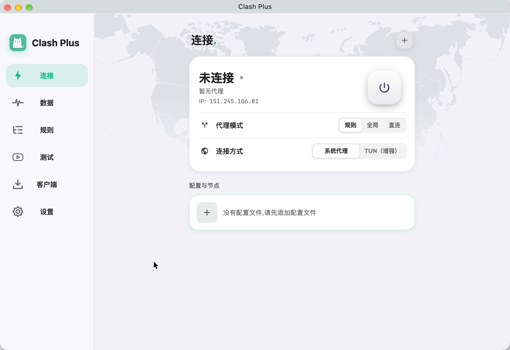

# 跨平台软件包


## 一、文档解析工具

### 1.MinerU

* 支持平台: Windows, Mac, Linux

* 官网: https://mineru.net

* 项目地址: https://github.com/opendatalab/mineru

## 二、🪜/代理客户端

### 1.Mihomo Party

* 支持平台: Windows, Mac, Linux

* 官网: https://mihomo.party/

* 项目地址: https://github.com/mihomo-party-org/mihomo-party

#### (1).覆盖配置示例
```yaml
# https://mihomo.party/docs/guide/override/yaml

+rules:
  - 'DOMAIN,manned.org,DIRECT'
  - 'DOMAIN,aur.archlinux.org,DIRECT'
  - 'DOMAIN-KEYWORD,beisen,DIRECT'
  - 'DOMAIN-SUFFIX,italent-inc.cn,DIRECT'
  - 'DOMAIN-SUFFIX,beisencorp.com,DIRECT'
  - 'DOMAIN-SUFFIX,aliyuncs.com,DIRECT'
  - 'DOMAIN-KEYWORD,alibaba-cloud,DIRECT'

#  - 'DOMAIN-SUFFIX,oracle.com,🔰 节点选择'

# 路由分离：这些网段的流量不走 Clash TUN，交还给系统路由（即 openconnect VPN 隧道）
# 否则 Clash 的 auto-route 会抢走公司网段，导致 VPN 后内网不通
tun:
  route-exclude-address:
    - 10.0.0.0/8            # 公司内网（10.129.x 等），走 VPN
    - 172.16.0.0/12         # 常见内网网段，兜底
    - 123.127.240.42/32     # VPN 服务器公网 IP，隧道流量直连，避免被 Clash 劫持

# 内网域名用公司内网 DNS 解析真实 IP（深合并进 dns 段）
# 关键：key 以 "+." 开头，必须用 <> 包裹，否则会被误解析为"插入操作"而丢弃
# 注意：nameserver-policy 匹配优先级 = 精确域名 > 通配符后缀
# 因此下面的 vpn.beisen-inc.com 精确规则会覆盖 +.beisen-inc.com 通配规则
dns:
  nameserver-policy:
    # VPN 入口是公网域名，在家/公网环境用公网 DNS 解析（精确匹配，优先级最高）
    'vpn.beisen-inc.com':
      - https://120.53.53.53/dns-query
      - https://223.5.5.5/dns-query
    '<+.beisencorp.com>':
      - 10.129.1.130
      - 10.129.6.131
    '<+.beisen-inc.com>':
      - 10.129.1.130
      - 10.129.6.131
    '<+.italent-inc.cn>':
      - 10.129.1.130
      - 10.129.6.131
```

### 2.Clash Plus

* 官网: https://clashplus.io/
* <span align="left" style="white-space: nowrap; vertical-align: middle;">多端适配：
  
  &nbsp;
  
  &nbsp;
  
  &nbsp;
  
  &nbsp;
  
  &nbsp;
  
  &nbsp;
  
  </span>
  
* 预览图：




* 安装

macos: 无`homebrew`包

### 3.FLClash

* 源码: https://github.com/chen08209/FlClash
* <span align="left" style="white-space: nowrap; vertical-align: middle;">多端适配：
  
  &nbsp;
  
  &nbsp;
  
  &nbsp;
  
  </span>
* 安装:
* macos
```shell
brew tap chen08209/tap
brew install --cask flclash
```

## 三、截图软件

### 1.pixpin
官网: https://pixpin.com/

### 2.Snow Shot
官网: https://snowshot.top/index.html
源码: https://github.com/mg-chao/snow-shot

## 四、AI 网关整流工具
### 1.cc-switch
官网: https://ccswitch.io/zh/
源码: https://github.com/farion1231/cc-switch


### 2.⭐ magpie

官网: https://usemagpie.ai/zh/
源码: https://github.com/yetone/magpie


安装
* macos
```shell
brew tap yetone/magpie-releases https://github.com/yetone/magpie-releases
brew trust --tap yetone/magpie-releases
brew install --cask magpie-app
```

卸载
* macos
```shell
brew uninstall --cask magpie-app
brew untap yetone/magpie-releases
```

## 五、剪贴板管理
### 1.⭐快贴KwikPaste

官网: https://paste.fastthree.com/
源码: https://github.com/ManSanDADADA/KwikPaste


## 六、终端
### 1.⭐<a id="Ghostty">Ghostty</a>

官网: https://ghostty.org/
源码: https://github.com/ghostty-org/ghostty

#### 1) 安装和卸载

1. 安装
* macos: `brew install ghostty`

2. 卸载
* macos: `brew uninstall ghostty`


#### 2) 配置文件

- 主配置文件（仓库路径）：

  <a href="./config/config.ghostty">通用配置文件</a>

- 实际运行路径（系统读取位置）：

  `/Users/witt/Library/Application Support/com.mitchellh.ghostty/config.ghostty`

> 当前做法是用软链接把系统路径指向仓库主文件，后续只维护仓库里的这一份配置。

#### 3) 关键能力与已知限制

1. 支持 `Quick Terminal`（下拉终端）与 `global:` 全局快捷键。
2. `global:` 快捷键依赖 macOS「辅助功能」权限。
3. macOS 下 `Quick Terminal` 不支持 tabs（官方已明确）。

> ⭐ [Ghostty2](https://github.com/pihalf/ghostty2) 是 Ghostty 的 fork，支持 Quick Terminal tabs。

#### 4) 参考资料

1. Ghostty 功能总览：https://ghostty.org/docs/features
2. Ghostty 配置参考（全部配置项）：https://ghostty.org/docs/config/reference
3. `toggle_quick_terminal` 说明：https://ghostty.org/docs/config/keybind/reference#toggle_quick_terminal
4. Quick Terminal tabs 限制讨论（官方回应）：https://github.com/ghostty-org/ghostty/discussions/2888

## 七、其他工具
### 1.Atuin
> Atuin 是一个终端历史记录工具，用于保存和检索终端命令。

官网: https://atuin.sh/
源码: https://github.com/atuinsh/atuin

#### 1) 安装和卸载

1. 安装
* macos: `brew install atuin`
* linux: `curl --proto '=https' --tlsv1.2 -LsSf https://setup.atuin.sh | sh`
* windows: `winget install -e Atuinsh.Atuin`

2. 卸载
* macos: `brew uninstall atuin`

#### 2) 配置

```fish
atuin init fish | source
```

[配置文件参考](./config/atuin-config.toml)

## 八、命令行工具

### 1.bat

> `cat` 的替代，带语法高亮与行号

* 源码: https://github.com/sharkdp/bat

* 安装
* macos: `brew install bat`
* linux: `sudo apt install bat`（Debian/Ubuntu）
* windows: `winget install sharkdp.bat`

### 2.fd

> `find` 的替代，语法更短，默认忽略 `.gitignore`

* 源码: https://github.com/sharkdp/fd

* 安装
* macos: `brew install fd`
* linux: `sudo apt install fd-find`
* windows: `winget install sharkdp.fd`

```shell
fd -e md              # 找所有 .md
fd -t d node_modules  # 找目录
```

### 3.fastfetch

> 终端启动信息展示，`neofetch` 的活跃替代品

* 源码: https://github.com/fastfetch-cli/fastfetch

* 安装
* macos: `brew install fastfetch`
* linux: `sudo apt install fastfetch`
* windows: `winget install Fastfetch-cli.Fastfetch`

### 4.tree

> 目录树展示

* 源码: https://github.com/Old-Man-Programmer/tree

* 安装
* macos: `brew install tree`
* linux: `sudo apt install tree`

```shell
tree -L 2 -a --dirsfirst
```

### 5.trash-cli

> 命令行删除进回收站，避免 `rm -rf` 不可逆

* 源码: https://github.com/andreafrancia/trash-cli

* 安装
* macos: `brew install trash-cli`
* linux: `sudo apt install trash-cli`

```shell
trash-put ./dist
trash-list
trash-restore
```

### 6.tlrc

> `tldr` 的 Rust 客户端，查命令示例比 `man` 快

* 源码: https://github.com/tldr-pages/tlrc

* 安装
* macos: `brew install tlrc`
* linux: `cargo install tlrc`

### 7.dos2unix

> 转换 Windows 换行符，处理 CRLF 脚本时常用

* 官网: https://dos2unix.sourceforge.io/

* 安装
* macos: `brew install dos2unix`
* linux: `sudo apt install dos2unix`

```shell
dos2unix scripts/*.sh
```

### 8.coreutils

> GNU 工具集，补齐 macOS 缺失的 `ls --color`、无备份 `sed -i` 等行为

* 官网: https://www.gnu.org/software/coreutils/

* 安装
* macos: `brew install coreutils`

> 命令带 `g` 前缀（`gls`、`gsed`），需要 GNU 行为时显式调用，不覆盖系统命令。

### 9.worktrunk

> git worktree 管理，多分支并行开发时避免反复 stash

* 源码: https://github.com/max-sixty/worktrunk

* 安装
* macos: `brew install worktrunk`

```shell
wt list
wt create feature-x
wt switch feature-x
```

## 九、开发工具

### 1.gh

> GitHub 官方 CLI，创建 PR / issue、查看 Actions 日志

* 官网: https://cli.github.com/
* 源码: https://github.com/cli/cli

* 安装
* macos: `brew install gh`
* linux: `sudo apt install gh`
* windows: `winget install GitHub.cli`

```shell
gh auth login
gh pr create --fill
gh run list --workflow xxx.yml
```

### 2.git-filter-repo

> 重写提交历史，用于清理敏感信息、拆分大仓库

* 源码: https://github.com/newren/git-filter-repo

* 安装
* macos: `brew install git-filter-repo`

```shell
# 从历史中彻底删除某文件
git filter-repo --path secrets.env --invert-paths
```

> 会重写全部 commit hash，操作前先备份分支。

### 3.Maven

* 官网: https://maven.apache.org/

* 安装
* macos: `brew install maven`

### 4.mvnd（Maven Daemon）

> 常驻守护进程的 Maven，连续构建比 `mvn` 快很多

* 源码: https://github.com/apache/maven-mvnd

* 安装
* macos: `brew install mvndaemon/mvnd/mvnd`

```shell
mvnd clean package -DskipTests
```

### 5.jadx

> Java / Android 反编译，可直接查看 jar、apk 的源码结构

* 源码: https://github.com/skylot/jadx

* 安装
* macos: `brew install jadx`

```shell
jadx -d out/ target.jar
jadx-gui target.jar
```

### 6.mat2

> 清除文件元数据（EXIF、作者、GPS 等），分享截图或文档前使用

* 官网: https://0xacab.org/jvoisin/mat2

* 安装
* macos: `brew install mat2`
* linux: `sudo apt install mat2`

```shell
mat2 photo.jpg         # 生成 photo.cleaned.jpg
mat2 --inplace doc.pdf
```

## 十、数据库客户端

### 1.Tiny RDM

> 轻量 Redis 客户端，支持集群、哨兵、JSON 类型

* 官网: https://redis.tinycraft.cc/zh/
* 源码: https://github.com/tiny-craft/tiny-rdm

* 安装
* macos: `brew install --cask tiny-rdm`
* windows: `winget install TinyRDM.TinyRDM`

### 2.DBeaver Community

> 通用数据库 GUI，支持 MySQL、PostgreSQL、Oracle、ClickHouse 等

* 官网: https://dbeaver.io/
* 源码: https://github.com/dbeaver/dbeaver

* 安装
* macos: `brew install --cask dbeaver-community`
* windows: `winget install dbeaver.dbeaver`

> 内置 JRE，无需额外配置 Java。启动较慢是正常现象。

### 3.DBX

> 轻量跨库数据库客户端

* 安装
* macos: `brew install --cask dbx`

### 4.iredis

> Redis 命令行增强版，支持语法高亮与自动补全

* 源码: https://github.com/laixintao/iredis

* 安装
* macos: `brew install iredis`
* linux: `pip install iredis`

```shell
iredis -h 127.0.0.1 -p 6379
```

### 5.mycli

> MySQL 命令行增强版，带语法高亮与自动补全

* 官网: https://www.mycli.net/
* 源码: https://github.com/dbcli/mycli

* 安装
* macos: `brew install mycli`
* linux: `pip install mycli`

```shell
mycli -h 127.0.0.1 -u root -p
```

## 十一、日常 GUI 软件

> 开箱即用的跨平台客户端，无特殊配置需求，仅记录安装命令。macOS 统一用 `brew install --cask`。

### 1.办公与协作

| 软件 | 平台 | 安装 |
| --- | --- | --- |
| WPS Office | Windows / macOS / Linux | `brew install --cask wpsoffice-cn` |
| 飞书 | Windows / macOS / Linux | `brew install --cask feishu` |
| 微信 | Windows / macOS / Linux | `brew install --cask wechat` |
| QQ | Windows / macOS / Linux | `brew install --cask qq` |
| 钉钉 | Windows / macOS / Linux | `brew install --cask dingtalk` |
| 企业微信 | Windows / macOS | `brew install --cask wechatwork` |
| Telegram | 全平台 | `brew install --cask telegram-desktop` |

> WPS 的 `wpsoffice-cn` 是中文版，与 `wpsoffice`（国际版）互斥，两者只能装其一。

### 2.浏览器

| 软件 | 平台 | 安装 |
| --- | --- | --- |
| Google Chrome | 全平台 | `brew install --cask google-chrome` |

### 3.开发 IDE 与 API 工具

| 软件 | 平台 | 安装 |
| --- | --- | --- |
| Visual Studio Code | 全平台 | `brew install --cask visual-studio-code` |
| GoLand | 全平台 | `brew install --cask goland` |
| IntelliJ IDEA | 全平台 | `brew install --cask intellij-idea` |
| PyCharm | 全平台 | `brew install --cask pycharm` |
| Apifox | 全平台 | `brew install --cask apifox` |
| Reqable | 全平台 | `brew install --cask reqable` |

> JetBrains 系三个 IDE 体积较大（各 3-4 GB），按需安装。`brew upgrade --cask` 会自动跟随大版本。

### 4.媒体与下载

| 软件 | 平台 | 安装 |
| --- | --- | --- |
| OBS Studio | 全平台 | `brew install --cask obs` |
| HandBrake | 全平台 | `brew install --cask handbrake-app` |
| Motrix | 全平台 | `brew install --cask motrix` |
| imFile | 全平台 | `brew install --cask imfile` |

### 5.AI 与编程助手

| 软件 | 平台 | 安装 |
| --- | --- | --- |
| ChatGPT | Windows / macOS | `brew install --cask chatgpt` |
| Cherry Studio | 全平台 | `brew install --cask cherry-studio` |
| DeepSeek Harness | 待确认 | `brew install --cask deepseek-harness` |
| Trae CN | 待确认 | `brew install --cask trae-cn` |
| OpenIDEA | Windows / macOS / Linux | `brew install --cask witt/taps/openidea` |
| ZCode | 待确认 | `brew install --cask zcode` |
| WorkBuddy | 待确认 | `brew install --cask workbuddy-cn` |

> `OpenIDEA` 未进入官方 cask 库，由本仓库私有 tap 提供，需先 `brew tap witt/taps`。

### 6.效率与同步

| 软件 | 平台 | 安装 |
| --- | --- | --- |
| Heynote | 全平台 | `brew install --cask heynote` |
| MiaoYan | macOS | `brew install --cask miaoyan` |
| Xmind | 全平台 | `brew install --cask xmind` |
| SwitchHosts | 全平台 | `brew install --cask switchhosts` |
| LocalSend | 全平台 | `brew install --cask localsend` |
| 小米互联服务 | Windows / macOS | `brew install --cask hyperconnect` |
| 阿里云盘 aDrive | Windows / macOS | `brew install --cask adrive` |
| ToDesk | 全平台 | `brew install --cask todesk` |
| Cap | Windows / macOS | `brew install --cask cap` |
